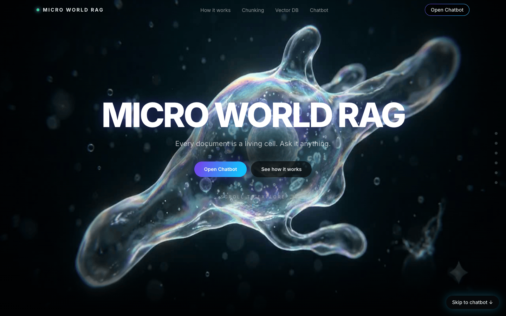
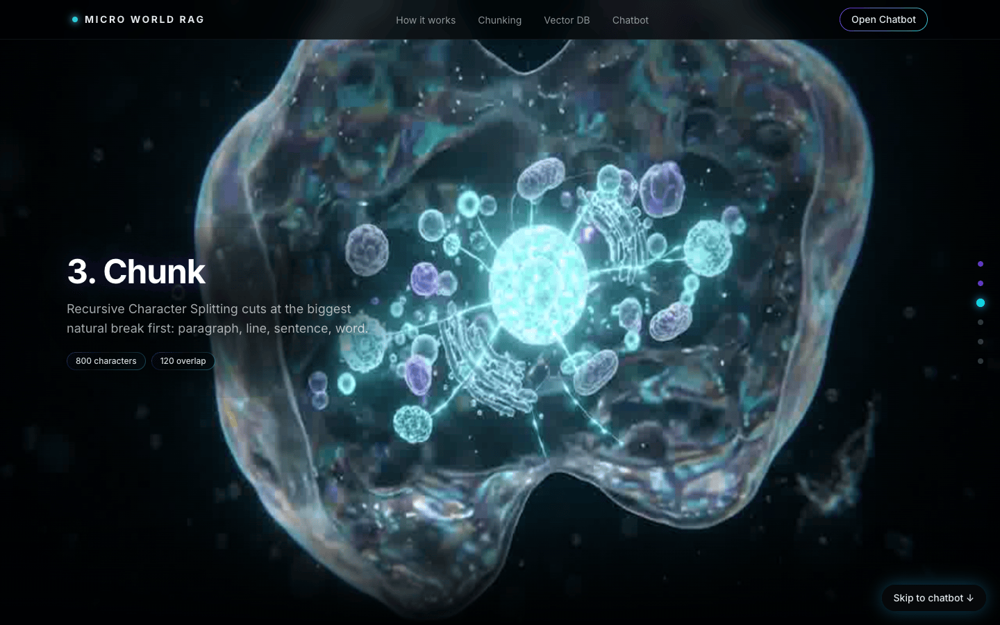
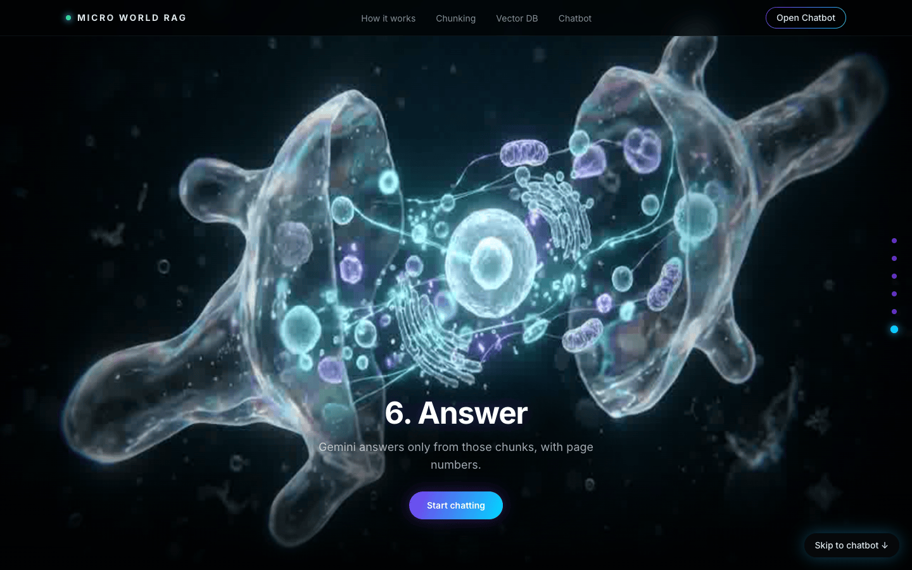
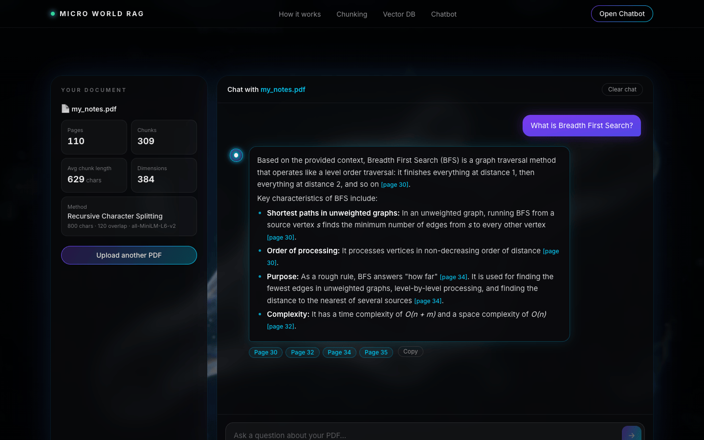
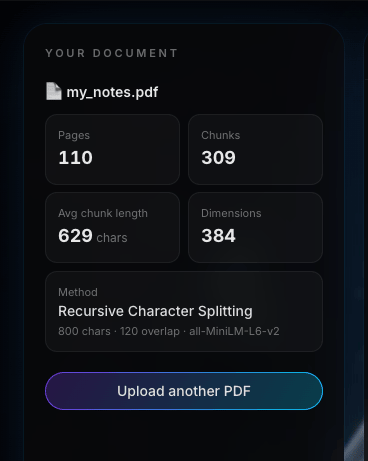
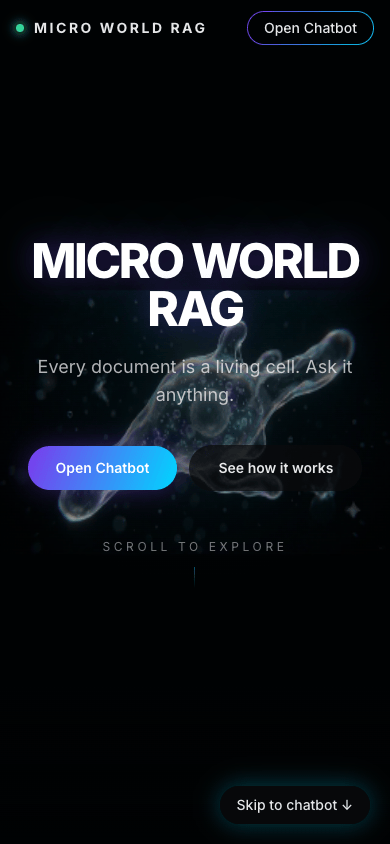

# MICRO WORLD RAG

Chat with any PDF. Upload a file, and the chatbot answers **only from that PDF**, with page numbers for every answer. If the answer is not in your PDF, it says so.

*Every document is a living cell. Ask it anything.*

A cinematic, 3D-feeling scroll intro (a glowing amoeba whose membrane opens and whose organelles float apart) explains how the chatbot works, step by step. Then you land in the chatbot itself, with the cell still breathing behind the glass panels.

## Screenshots


*The home page: the title MICRO WORLD RAG over a glowing amoeba cell.*

| | |
| --- | --- |
|  |  |
| *Step 3 of the scroll story: how the PDF is cut into chunks.* | *Near the end of the intro, the cell opens up and its parts float apart.* |
|  |  |
| *The chatbot answers "What is Breadth First Search?" with page numbers.* | *The sidebar shows stats for your PDF: pages, chunks and more.* |

<p align="center"></p>
<p align="center"><em>The home page on a phone.</em></p>

## Features

- **Chat with your PDF**: answers come only from your document, with page citations like `[page 12]`
- **Source chips**: every answer shows the pages it used; hover or tap to see the text snippet
- **Follow-up questions**: "and its time complexity?" works, because the question is rewritten using the last 4 messages
- **Honest answers**: if the PDF does not contain the answer, the bot says it does not know
- **Live pipeline tracker**: watch Upload → Load → Clean → Chunk → Embed → Vector DB → Ready
- **Document stats**: pages, chunks, average chunk length, chunking method, embedding size
- **Scroll storytelling intro**: a 238-frame amoeba image sequence drawn on a canvas, controlled by scroll
- **Living chat background**: the same frames loop slowly behind the chat and glow brighter while the bot is typing
- **3D feel with CSS + Framer Motion only**: opening cell-division animation, mouse tilt, nucleus zoom, magnetic buttons (off on touch devices and with reduced motion)
- **Skip to chatbot**: one click if you do not want the intro
- Dark, glassmorphism UI, responsive, respects `prefers-reduced-motion`

## Tech stack

| Part | Tools |
| --- | --- |
| Frontend | Next.js 14 (App Router), TypeScript, Tailwind CSS, Framer Motion, HTML5 Canvas |
| Backend | Python, FastAPI, Uvicorn |
| RAG | LangChain, PyPDFLoader, RecursiveCharacterTextSplitter, HuggingFace embeddings (`all-MiniLM-L6-v2`), Chroma, Gemini (`langchain-google-genai`) |

## How the chatbot works

The chatbot answers **only from your PDF**. It never uses outside knowledge, and every answer cites pages.


1. **Upload**: you upload one PDF (max 20 MB). It is saved to `data/uploads/`.
2. **Load**: `PyPDFLoader` reads the PDF page by page. Every page keeps its page number.
3. **Clean**: broken words are joined, page numbers are removed, repeated headers and footers are erased, and extra spaces are fixed.
4. **Recursive Character Splitting**: the text is cut into chunks of **800 characters** with **120 characters of overlap**. It cuts at the biggest natural break first: paragraph, then line, then sentence, then word.
5. **Embed**: each chunk becomes 384 numbers with **all-MiniLM-L6-v2**. Chunks with similar meaning get similar numbers.
6. **Chroma**: all chunks are stored in a Chroma vector database. A new upload replaces the old one, so the bot always answers from the latest PDF.
7. **Follow-ups**: if there is chat history, your question is first rewritten into a stand-alone question using the last 4 messages (so "what is its time complexity?" works).
8. **Gemini answer**: the question finds the 4 closest chunks (retrieved once). Gemini reads only those chunks and answers with page numbers like `[page 12]`. The same 4 chunks become the source chips. If the chunks do not contain the answer, it says it does not know.

## How to run

You need [uv](https://docs.astral.sh/uv/), Node.js 18+, and a free Gemini API key from https://aistudio.google.com/apikey.

### 1. Backend (Terminal 1)

```bash
cd rag_chatbot
cp .env.example .env          # then put your key in .env: GOOGLE_API_KEY=...
uv sync
uv run uvicorn api:app --reload --port 8000
```

The API runs at http://localhost:8000 (`/health`, `/status`, `/upload`, `/ask`).

### 2. Frontend (Terminal 2)

```bash
cd rag_chatbot/web
cp .env.example .env.local    # optional, the default is http://localhost:8000
npm install
npm run dev
```

Open http://localhost:3000, upload a PDF, and start chatting.

### Terminal-only version

```bash
uv run python ingest.py     # builds the database from my_notes.pdf (put your own PDF in this folder first)
uv run python chatbot.py    # ask questions in the terminal, type "exit" to quit
```

## Project files

- `api.py`: FastAPI server (upload, ask, status, health)
- `config.py`: all settings
- `loader.py`: loads the PDF page by page
- `cleaner.py`: cleans the text
- `chunker.py`: Recursive Character Splitting
- `vectorstore.py`: embeddings and the Chroma database
- `ingest.py`, `chatbot.py`: the original terminal version
- `web/`: the Next.js app (`components/`, `lib/api.ts`, `lib/frames.ts`, `public/frames/`)

---

Built by **Tanu Saini** · Mirai School of Technology · [github.com/saini16tanu](https://github.com/saini16tanu)
